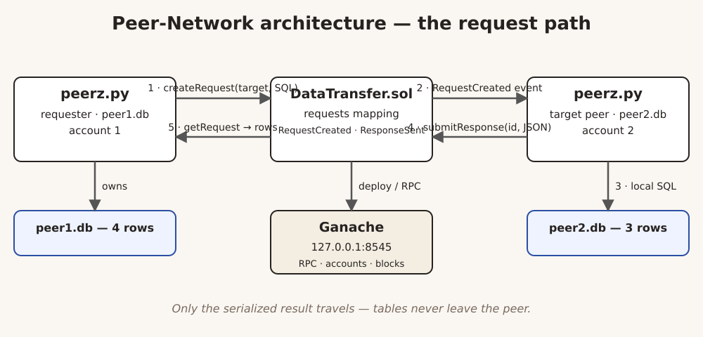
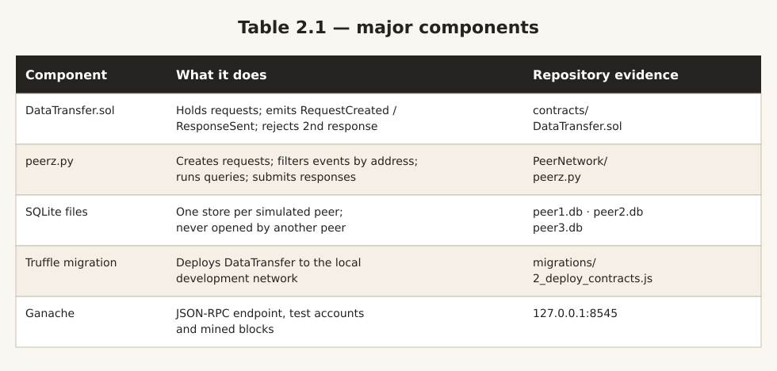
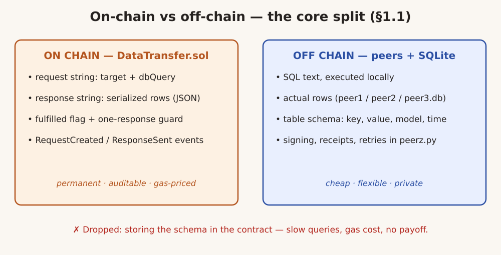
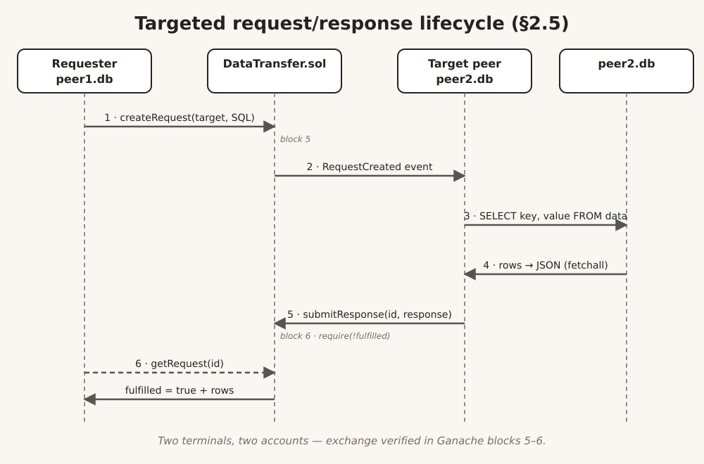
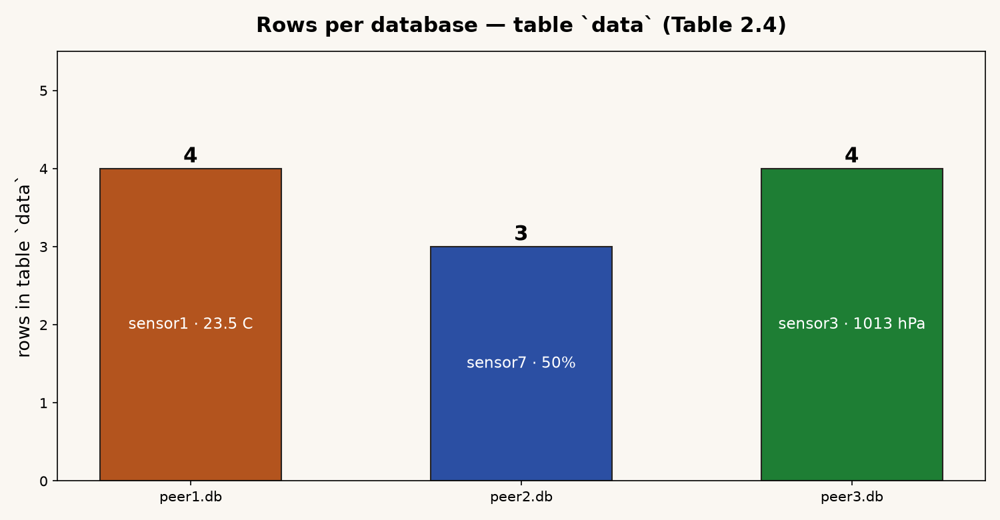
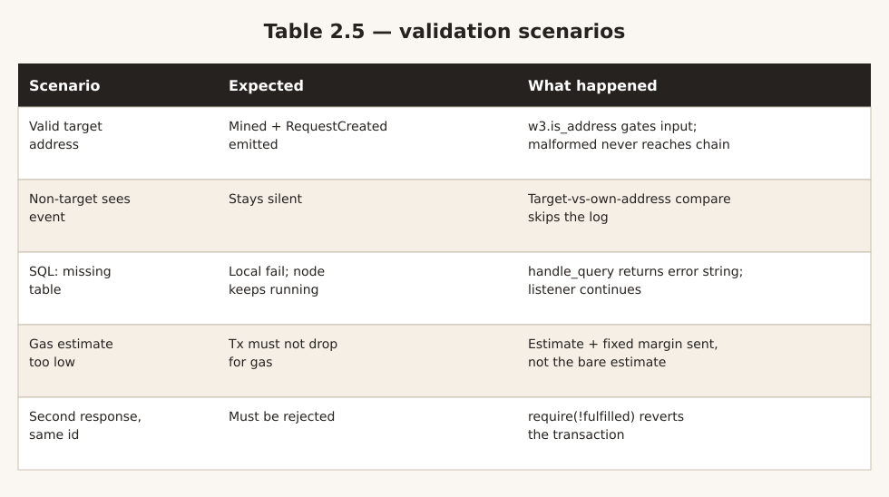
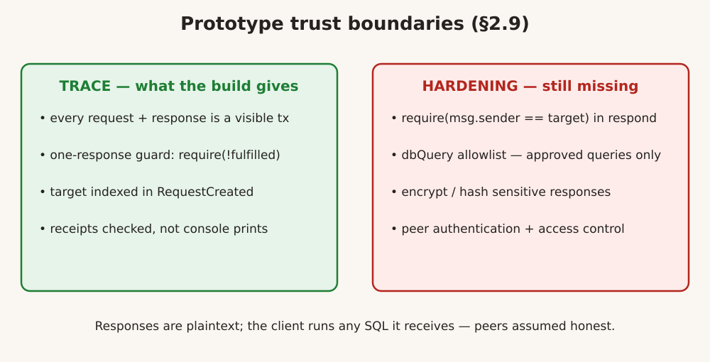

Title: Blockchain-Based Peer-to-Peer Data Exchange System
Author: Aditya Sharma
Theme: editorial

# Blockchain-Based Peer-to-Peer Data Exchange System

Industrial Training Report — IIT Indore, 2 June to 4 July 2025

Supervisor: Dr. Ayan Mondal · `github.com/VariableThe/Peer-Network`

> Notes: 30 seconds. Name, project, place, period. One line: a working prototype where peers exchange data rows and every request and response is recorded on chain.

---

# Training context and methodology

- Summer research-style training in CSE at **IIT Indore**, guided by **Dr. Ayan Mondal**
- Brief: reduce "decentralized data exchange" to a one-paragraph problem, then build it
- Two loops over five weeks: reading (accounts, storage vs events, Truffle) plus code (Solidity, Python, SQLite)
- Most days ended in a failing test; the next day started from the failure, not from scratch

> Notes: 30 seconds. This was a build-and-verify placement, not a survey. Set expectations: Ganache prototype, not production.

---

# Background: the problem

- Handing over a whole database is rarely what anyone wants — usually a few rows, one question, plus a record
- Server logs can record exchanges, but whoever runs the server decides what gets recorded
- Goal: a shared, tamper-visible record of *who asked what, who answered, with what*

> Notes: 30 seconds. Motivate decentralization in one sentence: the record should not belong to one party.

---

# Objectives of the training

1. State a decentralized data exchange precisely enough that a prototype answers it — not a survey of the area
2. Implement the full request lifecycle in Solidity: create request, record response, read it back
3. Run real queries against peer-owned SQLite databases from Python via Web3.py — no canned data
4. Deploy on Ganache with Truffle, verify end to end, then record what production still needs

> Notes: 30 seconds. These four objectives from section 1.2 map directly onto the demo: contract, client, data, deployment.

---

# Scope and delimitations

- Everything runs on **Ganache at `127.0.0.1:8545`** — no public chain, no testnet, no consensus between parties
- `DataTransfer` carries **metadata only** (request/response strings) — nothing confidential belongs in it
- SQLite stands in for the databases real peers would own; small and repeatable by design
- Security, performance, fault tolerance, and encryption are **out of scope** — gaps are recorded, not hidden

> Notes: 30 seconds. Name the ceiling early. Credibility comes from stating what this is not.

---

# System architecture



- Request path: `createRequest` with target plus SQL, target sees the event, queries locally, `submitResponse`, requester reads via `getRequest`
- Each step verified against Ganache receipts — a sent transaction is not a mined one

> Notes: 30 seconds. Walk the numbered arrows. Only the serialized result travels; tables never leave the peer.

---

# Component responsibilities



- Five pieces, each with repo evidence: contract, client, databases, migration, chain
- The classic failure was staleness between them — most often the contract address after a redeploy

> Notes: 30 seconds. Point at the evidence column: every claim in this deck traces to a file in the repo.

---

# Design decision: on chain vs off chain



- Dropped alternative: storing the schema in the contract — slow queries, gas cost, no payoff
- Small sensor tables keep responses short enough to fit on chain

> Notes: 30 seconds. This split is the backbone of the whole project — return to it in Q and A.

---

# Smart contract: the Request record

- `requester` (`address`) — account that called `createRequest`
- `target` (`address`) — account expected to answer; event filtering compares against this
- `dbQuery` (`string`) — SQL the target peer executes locally
- `fulfilled` (`bool`) — false at creation, set true by the first accepted response
- `response` (`string`) — serialized rows returned by the responding peer
- Records live in a mapping keyed by uint; IDs start at 1 and increment

> Notes: 30 seconds. Table 2.2 as bullets: five fields, one mapping, no access control and no fees — the round trip itself was under test.

---

# Contract interface and event model

```solidity
struct Request {
    address requester;
    address target;
    string dbQuery;
    bool fulfilled;
    string response;
}

event RequestCreated(uint indexed requestId,
    address indexed requester, address indexed target,
    string dbQuery);
```

- Peers live off logs, not getters — events matter more than functions
- Two honest gaps: `submitResponse` never checks `msg.sender == target`; `dbQuery` is a free string

> Notes: 30 seconds. The target field arrived late and turned broadcast into directed traffic. Name both gaps before anyone asks.

---

# Key pivot: broadcast to directed

- Early versions: every peer answered every request — duplicate answers, noisy terminals
- Fix: `createRequest` takes `_target`; `RequestCreated` indexes it; clients filter cheaply
- `peerz.py` drops any log whose target is not its own address
- Caveat: filtering lives in Python, not enforced by the contract

> Notes: 30 seconds. The main mid-project pivot. A lower-casing fix for checksummed addresses unblocked it.

---

# Peer client: peerz.py

- `make_request` — validates the target, estimates gas with a margin, signs and sends `createRequest`
- `listen_for_requests` — scans new blocks for `RequestCreated`, reacts only to its own address
- `handle_query` — opens the local SQLite file, runs the SQL, serializes rows to JSON
- `send_response` — signs and sends `submitResponse`; `ResponseSent` emitted
- `get_response` — calls `getRequest` so the requester sees the fulfilled flag plus rows

> Notes: 30 seconds. Table 2.3 as bullets. Startup takes four inputs — RPC URL, contract address, private key, db path — and stale ones caused most failures.

---

# Event filtering: the real code

```python
target = event_data.args.target
req_id = event_data.args.requestId
db_query = event_data.args.dbQuery

if target.lower() == acct.address.lower():
    response = handle_query(db_path, db_query)
    send_response(req_id, response)
else:
    print(f"Request {req_id} not for this peer")
```

- Lower-casing fixed the checksum mismatch that silently dropped every valid request
- Filters live in the Python process — editable, unenforced, but cleanly separated

> Notes: 30 seconds. This snippet is the directed-traffic mechanism. On chain the record, off chain the query — enforcement still to add.

---

# Request/response lifecycle



- Two terminals, two accounts, two databases; requester sends `SELECT key, value FROM data` to peer2's address
- `require(!fulfilled)` makes a replayed second response revert

> Notes: 30 seconds. Walk the six arrows. In the demo run this exchange sits in blocks 5 and 6 of the Ganache log.

---

# SQLite data: peer-owned test tables



- Same schema everywhere (`key, value, model_number, timestamp`), different rows per file
- Deliberately dull data: sensor readings that prove the mechanism without bloating gas
- Nothing in an exchange mutates the tables — rows are read where they live

> Notes: 30 seconds. Table 2.4 as a chart: 4, 3, 4 rows. Small tables keep responses short enough for chain storage.

---

# Deployment and dev flow

1. Start Ganache; record the RPC URL, accounts, and private keys it prints
2. Run `truffle compile`, then `truffle migrate --network development` (solc 0.8.21)
3. Paste the deployed contract address into each peer run — different account, different `.db` path
4. Open two clients, send a request, call `getRequest` on the requester: flag true, rows attached

> Notes: 30 seconds. Compiler versions must agree — a 0.8.19 versus 0.8.21 mismatch once produced an incompatible artifact.

---

# Testing and validation



- Standing test before and after every change: two peers, two accounts, two DBs, one valid SELECT
- Typical breakages were all at interfaces: ports, pasted addresses, ABI mismatch, casing, gas, unmined txs, DB paths

> Notes: 30 seconds. The contract was the least troublesome part; the glue between RPC, ABI, accounts, events, and SQL is where the weeks went.

---

# Security and limitations



- Scope was deliberate: prove the loop behaves as designed; hardening is recorded, not claimed
- Ganache dev chain, unaudited contract — coursework with a working example

> Notes: 30 seconds. Lead with the ceiling. Plaintext responses and client-run SQL assume honest peers and benign queries.

---

# Repository organization

- README covers install, prerequisites, contract interface, peer usage, deployment, and troubleshooting
- Earlier peer scripts are kept alongside `peerz.py` — dead ends preserved, not deleted
- Address, ABI, compiler version, and DB path must all line up; a note of which address belongs to which deploy saved rebuilds

> Notes: 30 seconds. Figure 2.8 in one line: any future blockchain work starts from that alignment note, not from the contract.

---

# Learnings: technical

- **Solidity** — structs, mappings, events, `require`, and the cost of every storage write
- **Web3.py** — building, signing and sending transactions, waiting on receipts, decoding events
- **Event-driven design** — using mined logs as the trigger for work in a separate process
- **SQLite** — running queries locally and serializing results for transport
- **Cross-layer debugging** — following one failure through RPC, ABI, accounts, events, and SQL
- **Security judgement** — listing what the demo omits and why each omission matters

> Notes: 30 seconds. Table 3.1 as bullets. Terms once only read about — receipt, ABI, gas estimation — became things personally broken at least once.

---

# Lesson: the week-two turning point

- On chain versus off chain stopped being theory: rules and permanent state belong in Solidity; signing, gas, receipts, retries belong in the client
- A chain buys tamper-checking and shared state — charged in gas, latency, and exposure
- Writing a row to SQLite costs nothing; the same row on chain costs gas and needs a custom reader
- Deciding that field by field, for a handful of sensor readings, is what every blockchain design must do

> Notes: 30 seconds. The supervisor's recurring question — why does this need to exist on chain — shaped every DataTransfer.sol decision.

---

# Conclusion

- Five weeks produced a prototype that does one thing completely: request, record, targeted observe, local answer, read-back
- Three terminals, one contract, three SQLite databases — the loop holds run to run
- Keep the split: the chain coordinates, peers own their data, neither does the other's job
- Most of the work was unglamorous: ABI matching, manual signing, receipt waits, address normalization, gas margins, error-as-string returns

> Notes: 30 seconds. One line to land on: a prototype that does one thing completely beats a survey that does nothing.

---

# Next steps and future work

1. Enforce `msg.sender == target` in `submitResponse` before accepting a response
2. Restrict `dbQuery` to a set of approved queries — an allowlist, not a free string
3. Move anything sensitive off chain; encrypt or hash what must be referenced on chain
4. Authenticate peers and add access control over who can create requests
5. Carry the unchanged core loop past Ganache toward a real network

> Notes: 30 seconds. Enforcement first, privacy second, real network last. The core loop does not need to change for any of it.

---

# Thank you

Peer-Network — `github.com/VariableThe/Peer-Network`

References: Solidity, Ganache, SQLite, Truffle, and Web3.py documentation; ITR report, IIT Indore, September 2026

> Notes: 30 seconds. Invite questions on the repo, the annexures, and the hardening list. The code excerpts in the appendix back every claim.
