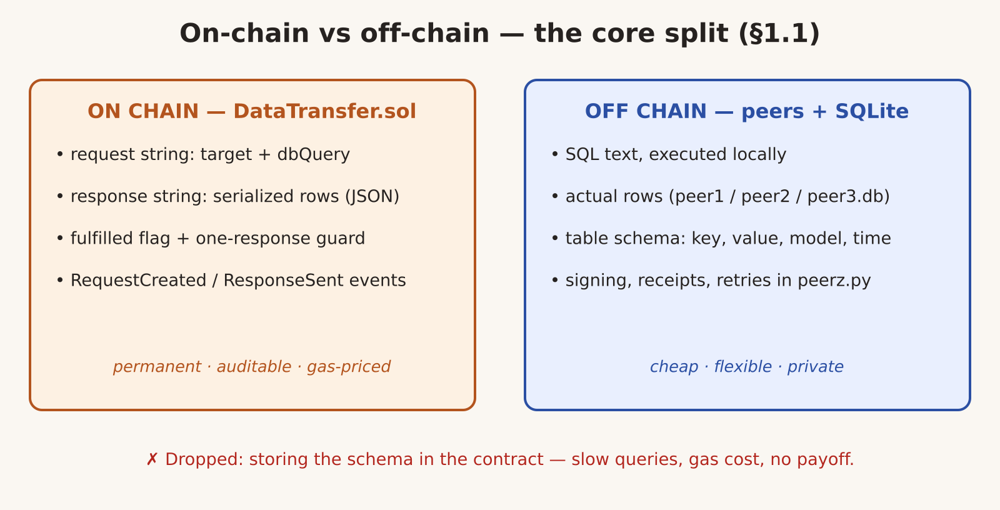
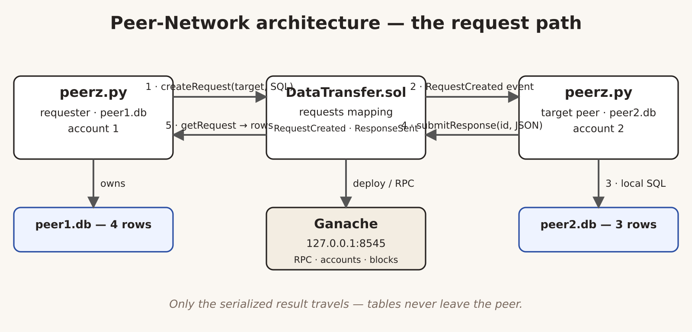
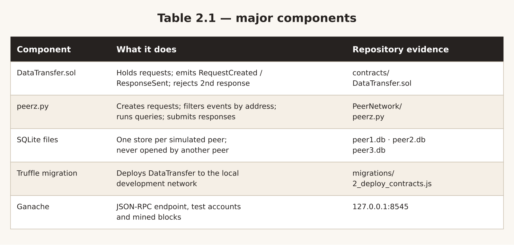
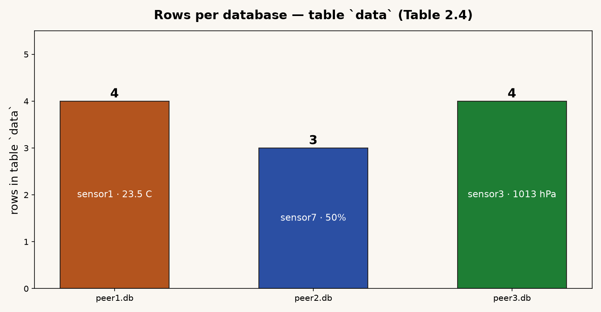
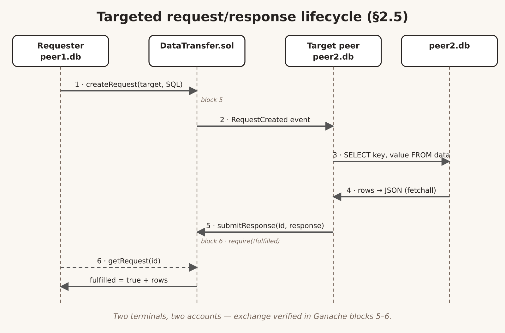
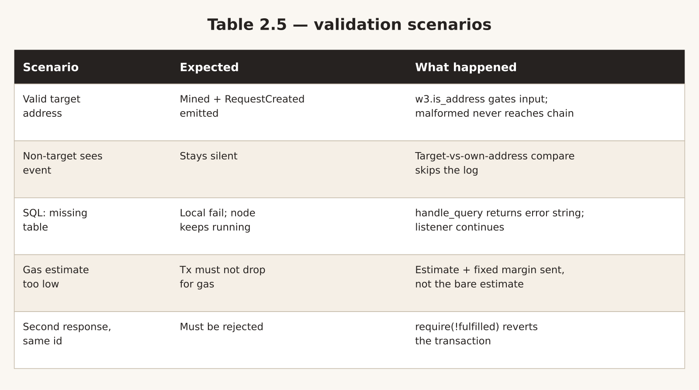
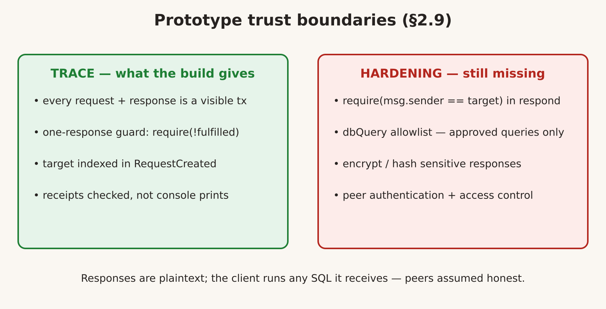

# Executive Summary

Peer-Network is a prototype blockchain-based peer-to-peer data exchange system built during a five-week industrial training placement (2 June–4 July 2025) in the Department of Computer Science and Engineering at the Indian Institute of Technology Indore, under the supervision of Dr. Ayan Mondal (Assistant Professor), and submitted in partial fulfilment of training requirements for the B.Tech in Computer Science and Financial Technology at the Manipal Institute of Technology. The repository is hosted at github.com/VariableThe/Peer-Network. The system answers a single, precisely stated problem: server logs are owner-controlled, so whoever runs the server decides what gets recorded; Peer-Network replaces the server log with a shared, tamper-visible on-chain record of who asked what, who answered, and with what. A Solidity contract named DataTransfer holds small request and response strings that are cheap to store and permanent enough to audit, while the actual data — SQL statements, result rows, and table schemas — stays off-chain in peer-owned SQLite files because querying on-chain is slow and writing on-chain costs gas. One peer raises a directed request naming a target address, the targeted peer's Python client (peerz.py, built on Web3.py) detects the RequestCreated event, runs the SQL against its own database, serialises the rows to JSON, and writes the response back on-chain with submitResponse; the requester then reads the fulfilled record with getRequest. Development and deployment ran entirely on a local Ganache chain (JSON-RPC 127.0.0.1:8545) with Truffle migrations, solc 0.8.21, three SQLite databases (peer1.db with 4 rows, peer2.db with 3 rows, peer3.db with 4 rows), and a demo exchange verified across blocks 5 and 6. Five validation scenarios — valid-target mining, non-target silence, missing-table SQL survival, gas-estimate margining, and second-response rejection via require(!fulfilled) — were exercised against the running system. The prototype is deliberately not production-hardened: responses are plaintext, the contract never checks msg.sender against the stored target, and dbQuery is an unrestricted free string. This report documents the design, the broadcast-to-directed pivot that made the system work, the deployment loop, the test evidence, the known gaps, and the concrete hardening steps that a next version should take first.

# Introduction

## 2.1 Background

Handing over an entire database is rarely what anyone actually wants. The common case is smaller: a few rows of data, the answer to a single question, and some record that the exchange happened. A client-server setup provides that record in the server log — and because of that, whoever runs the server decides what gets recorded.

The work described here builds the other setup. A Solidity contract called DataTransfer records who requested what and what was returned. Each peer keeps its data in a separate SQLite file — peer1.db, peer2.db, and peer3.db in the repository — and each peer only ever reads from its own database. Between chain and database sits a Python client written with Web3.py that submits requests, listens for RequestCreated events, and responds when an event names its own account as the target.

The training setting was closer to a summer research project than a company posting: a broad area, decentralised data exchange, reduced to a problem statable in one paragraph and teachable by running code, with an honest summary at the end. Work ran in two loops across the five weeks. The first was reading — Ethereum accounts and transactions, the difference between contract storage and events, why tooling such as Truffle exists at all. The second was code — a Solidity contract, Python peers, three SQLite files, and the deployment scripts around them. Most days ended with a failing test for something unexpected and a sentence describing why; the next day started from that sentence rather than from scratch.

## 2.2 Problem Statement

Server logs are owner-controlled. Any claim of the form "peer A asked peer B for these rows and received that answer" is only as trustworthy as the machine that wrote the log line, and that machine belongs to one of the parties. The problem Peer-Network addresses is how to produce a shared, tamper-visible record of a data exchange — who asked what, who answered, with what — without handing either party unilateral control of the record, and without moving the underlying data itself onto an expensive, slow, fully public store.

## 2.3 Objectives

The training objectives, set at the start of the placement, were fourfold:

- State a decentralised data exchange precisely enough that a prototype could answer the problem rather than survey the area.
- Implement the full request lifecycle in Solidity, from creating a request to recording a response to reading that response back by the request's creator.
- Run real queries against peer-owned SQLite databases from Python using Web3.py, so that the off-chain half of the system does genuine work rather than returning canned data.
- Deploy on Ganache with Truffle, verify the implementation's behaviour end to end, and then record what is still missing for a production setup.

## 2.4 Scope and Delimitations

The prototype's boundaries were fixed early and held throughout:

- Everything runs on Ganache at 127.0.0.1:8545. There is no public chain, no testnet, and no consensus between independent parties to reason about.
- DataTransfer carries request and response metadata. It was not designed to carry large payloads, and nothing written into it should be treated as confidential.
- SQLite stands in for the databases a real peer would own. This keeps the demonstration small and the tests repeatable.
- The measure of success is that the workflow behaves as designed. Security, performance, fault tolerance, and encryption are out of scope; Section 10 records what is lacking and why each gap matters.

# Design Overview

## 3.1 On-Chain vs Off-Chain Split

The central design decision is what lives on the chain and what does not. On-chain are a request string and a response string: small enough to store, permanent enough to audit. Off-chain are everything too expensive or too slow for the chain — the SQL itself, the actual result rows, and the table schemas. An alternative design that stored the schema in the contract was considered and dropped: querying on-chain is slow, writing on-chain costs gas, and the chain keeps nothing affordably. The demonstration tables hold three small sets of deliberately dull sensor readings, which keeps responses short enough to fit on-chain comfortably.



## 3.2 System Architecture

Peer-Network is four pieces. DataTransfer.sol holds state and emits events. One Python process per peer (peerz.py) sends transactions and listens for logs. Each peer keeps its own rows in a separate SQLite file and is the only process that opens that file. Ganache provides the JSON-RPC endpoint everything points to — 127.0.0.1:8545 — along with the test accounts used for signing.

The path of a request is short. The requester calls createRequest with a target address and a SQL query. The targeted peer observes RequestCreated in a new block, compares the event's target field against its own address, and on a match queries its own database, converts the rows to JSON, and calls submitResponse. The requester then calls getRequest to read back the request, the fulfilled flag, and the answer. Every step was verified against Ganache receipts rather than console output, because a sent transaction is not a mined transaction.



The component responsibilities and their repository evidence are summarised below, and the same summary is rendered as a diagram asset reused from the project presentation.

| Component | What it does | Repository evidence |
|---|---|---|
| DataTransfer.sol | Holds request records, emits RequestCreated and ResponseSent, rejects a second response | PeerNetwork/Project/contracts/ |
| peerz.py | Creates requests, filters events against its own address, runs local queries, submits responses | PeerNetwork/peerz.py |
| SQLite files | One data store per simulated peer, never opened by any other peer | peer1.db, peer2.db, peer3.db |
| Truffle migration | Deploys DataTransfer to the local development network | migrations/2_deploy_contracts.js |
| Ganache | Provides the JSON-RPC endpoint, the test accounts, and the mined blocks | Runs at 127.0.0.1:8545 |



# Smart Contract: DataTransfer.sol

DataTransfer.sol is as small as a contract can be while still doing something. There is no access control and no fee model in it, because the round trip — request, directed delivery, single recorded response — is what was being tested.

## 4.1 The Request Record

A Request holds five fields. Records are kept in a mapping keyed by an unsigned integer, starting at 1 and incrementing on every createRequest.

```solidity
struct Request {
    address requester;
    address target;
    string dbQuery;
    bool fulfilled;
    string response;
}
```

| Field | Type | Purpose |
|---|---|---|
| requester | address | Account that called createRequest. |
| target | address | Account expected to answer; event filtering compares against this. |
| dbQuery | string | SQL statement the target peer executes locally. |
| fulfilled | bool | False at creation, set true by the first accepted response. |
| response | string | Serialised rows returned by the responding peer. |

Three functions cover the lifecycle. `createRequest` instantiates a new struct, sets `fulfilled` to false, and emits `RequestCreated`. `submitResponse` requires that `fulfilled` is still false (`require(!fulfilled)`), then writes the response string, sets the flag, and emits `ResponseSent`. `getRequest` is a view that returns the struct's fields to the caller. From the client's point of view the events matter more than the functions, since the peers are built around logs and would otherwise have to poll each ID in the mapping.

## 4.2 Contract Interface and Event Model

The target address arrived late in the design. The first scripts had no concept of a destination, so every peer interpreted every event as addressed to itself. In the current interface, `createRequest` takes `_target` as its first argument, and `RequestCreated` carries it as an indexed field so clients can filter on it cheaply:

```solidity
event RequestCreated(uint indexed requestId,
    address indexed requester, address indexed target,
    string dbQuery);
```

The full request-creation function, as it stands in PeerNetwork/Project/contracts/DataTransfer.sol, is:

```solidity
function createRequest(address _target, string calldata _dbQuery)
    external returns (uint)
{
    uint requestId = nextRequestId++;
    requests[requestId] = Request({
        requester: msg.sender,
        target: _target,
        dbQuery: _dbQuery,
        fulfilled: false,
        response: ""
    });
    emit RequestCreated(requestId, msg.sender, _target, _dbQuery);
    return requestId;
}
```

`submitResponse` contains the guard `require(!fulfilled)` before it writes anything, then emits `ResponseSent`. In testing, that line is what rejected the duplicate answers produced by the early broadcasting versions of the peer client.

Two gaps must be stated before this reads as a security design. `submitResponse` never verifies that the stored target equals `msg.sender`, so any account can answer any request. `dbQuery` is a free string, so a peer runs whatever text it is passed. Neither is fixed in this build; both reappear in Section 10 with the hardening each requires.

## 4.3 The Broadcast-to-Directed Pivot

The main engineering decision of the project was the shift from broadcasting to directed traffic. The first four peer designs had every peer respond to every request, which produced duplicate answers and unreliable terminals as soon as two peers were running. The final design has `createRequest` take an explicit destination, `RequestCreated` index it, and each client drop any log naming another destination. That single change — a target field threaded from function argument through event index to client-side filter — turned a broadcast network into a directed one, and everything after it (the lifecycle, the validation scenarios, the demo run) depends on it.

# Peer Client: peerz.py

peerz.py is a console script, and almost everything that went wrong in the first week came from one of its four startup inputs being stale — most commonly the contract address after a redeploy.

## 5.1 Startup and Configuration

On startup the client takes four inputs: the RPC URL, the contract address, a private key, and a path to a `.db` file. It builds a Web3 instance, recovers an account from the private key, attaches the ABI to the contract address, and starts a listener thread before presenting a menu. The menu offers three operations. Creating a request validates the address with `w3.is_address`, estimates gas, adds a margin to the estimate, signs and sends the transaction, and waits for a receipt. Reading a result calls `getRequest` and attempts `json.loads` on the response so the caller sees fields rather than an escaped string. The margin on gas replaced a fixed estimate used earlier; the fixed estimate failed whenever a response grew beyond a few rows.

| Function | What it does | Result |
|---|---|---|
| make_request | Validates the target, estimates gas with a margin, signs and sends createRequest | A new request ID appears on-chain |
| listen_for_requests | Scans new blocks for RequestCreated and compares the target with its own address | Only the addressed peer reacts |
| handle_query | Opens the local SQLite file, runs the SQL, serialises rows to JSON | Result string, or an error string |
| send_response | Signs and sends submitResponse carrying the request ID and the result | Response stored, ResponseSent emitted |
| get_response | Calls getRequest for a given ID | Fulfilled flag and response shown to the requester |

## 5.2 Target-Aware Event Filtering

The listener scans the logs of new blocks for RequestCreated and decodes each one into requestId, dbQuery, and target. Before comparison, both the event's target field and the local account address are lower-cased: Ethereum returns checksummed addresses, and the first version of the filter — which compared raw strings — silently ignored every valid request. A match triggers `handle_query` on the configured database followed by `send_response`; a mismatch prints one line and moves on without touching the log:

```python
target = event_data.args.target
req_id = event_data.args.requestId
db_query = event_data.args.dbQuery

if target.lower() == acct.address.lower():
    response = handle_query(db_path, db_query)
    send_response(req_id, response)
else:
    print(f"Request {req_id} not for this peer")
```

None of this filtering is enforced by the contract — it lives in the Python process, and the process could be edited to answer anything. What the design provides is a clean separation: the record of the exchange happens on the chain, the query executes on the machine holding the database, and only the query's result travels. The enforcement still needs to be added.

## 5.3 Local Query Execution

`handle_query` opens the peer's own SQLite file, executes the SQL string from the event, fetches the rows with `fetchall()`, and serialises them to JSON for transport in `submitResponse`. If the SQL references a missing table or is otherwise invalid, the function returns an error string instead of raising: the node keeps running and the listener keeps scanning, which is the intended behaviour. Nothing in the exchange mutates the table — the rows are queried on the machine that owns the database, and only the serialised response is written on-chain.

# Data Layer: Peer-Owned SQLite

Each peer gets its own database so the demonstration has something real to read. All three files share one schema — `key`, `value`, `model_number`, `timestamp` — and differ only in content. peer1.db holds 4 rows, peer2.db holds 3, and peer3.db holds 4. The values are deliberately dull: sensor1 at 23.5 C on ModelA-123, sensor7 at 50% on ModelD-123, sensor3 at 1013 hPa on ModelC-789. Three small tables suffice to prove the point, and small tables keep responses short enough to fit on-chain.



| Database | Table | Rows in the checked-in file | A row from this file |
|---|---|---|---|
| peer1.db | data | 4 | sensor1, 23.5 C, ModelA-123 |
| peer2.db | data | 3 | sensor7, 50%, ModelD-123 |
| peer3.db | data | 4 | sensor3, 1013 hPa, ModelC-789 |

A representative local result — the expected rows for a `SELECT` against peer2.db — shows the shape of what `handle_query` serialises:

| key | value | model_number |
|---|---|---|
| sensor7 | 50% | ModelD-123 |
| sensor8 | 1010 hPa | ModelE-456 |
| sensor9 | 22.0 C | ModelF-789 |

# Request/Response Lifecycle

A run looks like this from the outside. Two terminals are open: one configured with peer1.db, the other with peer2.db, on different accounts. The first peer asks for `SELECT key, value FROM data` and passes the second peer's address as the target. `createRequest` is mined, the event fires, and the second terminal prints the incoming request because the target field matches its account. The second peer queries its own database, serialises the `fetchall()` rows, and calls `submitResponse` with the request ID; the contract's `require(!fulfilled)` means any replay of that call reverts. From the requester side, `getRequest` returns requester, target, query, flag, and response in a single call. In one verified demo run, that exchange spanned blocks 5 and 6, confirmable in the Ganache transaction list.



The standing check order for any change to the system is therefore fixed: start Ganache and deploy DataTransfer with `truffle migrate`; launch two clients on different accounts and different `.db` paths; send a `SELECT` from the first with the second's address as target; confirm the second matches, queries, and serialises; confirm `submitResponse` lands and `getRequest` on the requester returns `fulfilled == true` with the rows attached.

# Deployment and Development Environment

Deployment was local and stayed local. `truffle-config.js` defines a single network, `development`, at 127.0.0.1 on port 8545 with `network_id: '*'`, and pins solc 0.8.21. An earlier state of the README named 0.8.19; the mismatch was discovered during a compile that generated an incompatible artifact, and the two now agree. The migration itself is trivial: it loads the DataTransfer artifact and calls `deployer.deploy(DataTransfer)` (migrations/2_deploy_contracts.js).

The deployment loop, in order:

1. Start Ganache and record the RPC URL, the accounts, and the private keys it prints.
2. Run `truffle compile` followed by `truffle migrate --network development`.
3. Paste the deployed contract address into each peer invocation, giving each run a different account and a different `.db` path.
4. Open two clients, send a request from one to the other, and call `getRequest` on the requester once the target responds. The flag should be true and the response should contain rows.

Address, ABI, compiler version, and database path must all line up for a single run, and there are several ways to get each of them wrong for every one way to get them right. A standing note of which address belonged to which deploy saved repeated environment rebuilds, and any later blockchain work should start from that note rather than from the contract.

# Testing and Validation

Testing centred on one deliberately narrow case: two peers, two accounts, two databases, one valid SELECT. If the target detects its own event, reads from its own database, responds exactly once, and the requester gets back a fulfilled record, the system behaves as designed. That case ran reliably once the address comparison and gas estimation were fixed, and it was re-run before and after every change.

Everything that broke did so at an interface. Ganache listening on a different port than the client expected. An address pasted with a character missing. An ABI file not matching the recompiled contract. Address casing. A gas estimate a few hundred short. A signed transaction never mined. A log the decoder could not parse. A database path pointing at nothing. A SQL string with a typo — which returns an error string and keeps the node running, exactly as intended. Reading state back from the contract was the least troublesome part of the build.



| Scenario | Expected behaviour | What actually happened |
|---|---|---|
| Request created with a valid target address | Transaction is mined and RequestCreated emitted | `w3.is_address` runs before signing, so no malformed address reaches the chain |
| A peer other than the target sees the event | It should stay silent | peerz.py compares the target with its own account and skips the log |
| SQL references a missing table | Local call fails without killing the node | `handle_query` returns an error string and the listener keeps running |
| Gas estimate too low | Transaction should not be dropped for gas | Estimate plus a fixed margin is sent instead of the bare estimate |
| Second response for the same request | It must be rejected | `require(!fulfilled)` reverts the transaction |

# Security Considerations and Limitations

Peer-Network is not secure, and was not designed to be. What it offers is a trace: each request and each response is a transaction anyone can see, which is useful when the question is what occurred between two entities — and useless, on its own, as a confidentiality or authorisation story. A genuinely distributed system would need things this build does not have. Responses are stored as plaintext. The client runs whatever SQL string it is passed, which assumes honest peers and benign queries.



The target field suffers from the same class of weakness. It is stored, indexed, and consulted by the client — but the contract never verifies that the responder is the target. Closing that gap requires a `require` on `msg.sender` in `submitResponse`, access control over who may create requests, and restriction of `dbQuery` to a set of approved queries. Beyond that, results should be encrypted or hashed rather than written in plaintext, peers should be authenticated, and the exchange record should be reviewable by a third party. Concretely, the missing pieces are: request access control, an approved-query allowlist, encryption/hashing of responses, and peer authentication. The build stops well short of all of them, and that boundary is intentional: the prototype proves the coordination loop, not the hardening around it.

# Learnings and Impact

Somewhere around week two, the separation between on-chain and off-chain stopped being theory. Rules and state belong in Solidity because they are visible and permanent; keys, signing, gas, receipts, retries, and event polling belong in the client because they are cheap to change. Terms previously only read about — receipt, ABI, gas estimation, confirmation — became things personally broken at least once.

The second lesson was about databases. A chain buys tamper-evidence and shared state, and both are priced in gas, latency, and exposure. Writing a row to SQLite costs nothing and can be queried freely; writing the same row on-chain costs gas and can only be read back through a function written for the purpose. Choosing field by field, for a handful of sensor readings, what belongs where was a small instance of a decision every blockchain system has to make.

| Learning area | What it meant in practice |
|---|---|
| Solidity | Structs, mappings, events, require, and the cost of every storage write |
| Web3.py | Building, signing and sending transactions, waiting on receipts, decoding events |
| Event-driven design | Using mined logs as the trigger for work in a separate process |
| SQLite | Running queries locally and serialising the result for transport |
| Debugging across layers | Following one failure through RPC, ABI, accounts, events, and SQL |
| Security judgement | Listing what the demo omits and why each omission matters |

The cross-layer debugging skill proved the most durable: a single failed exchange could implicate the RPC endpoint, the ABI, the account, the event decoder, or the SQL, and each layer had to be checked in order rather than by guesswork. Earlier peer-script versions are kept alongside peerz.py in the repository rather than deleted, so the dead ends are preserved next to the path that worked.

# Conclusion and Future Work

Five weeks of training produced a prototype that does one thing completely. A request can be raised, recorded, observed by the peer it names, answered from that peer's own database, and read back by the requester. Three terminals, one contract, three SQLite databases — and the loop holds, run after run.

What should be kept is the split: the chain coordinates, the peers own their data, and neither is asked to do the other's job. The work that got it there was mostly unglamorous — matching an ABI to a deployed contract, manually signing transactions, waiting on receipts, normalising addresses, adding a margin to gas estimates, returning errors as strings instead of raising them. That is roughly where the weeks went.

A next version should start with enforcement: require `msg.sender` to equal the stored target before accepting a response, and restrict `dbQuery` to a set of approved queries. After that, anything sensitive should move off-chain, peers should be authenticated, and the exchange record should be reviewable by a third party. Deployment past Ganache comes last — the core loop would not have to change to carry any of that.

# References

- Ethereum Foundation. (n.d.). Solidity documentation. https://docs.soliditylang.org/
- Ganache. (n.d.). Ganache documentation. https://archive.trufflesuite.com/docs/ganache/
- SQLite Consortium. (n.d.). SQLite documentation. https://www.sqlite.org/docs.html
- Truffle Suite. (n.d.). Truffle documentation. https://archive.trufflesuite.com/docs/truffle/
- Web3.py. (n.d.). Web3.py documentation. https://web3py.readthedocs.io/
- VariableThe. (2025). Peer-Network [Source code]. GitHub. https://github.com/VariableThe/Peer-Network
- Sharma, A. (2025). Internship progress report [Unpublished training report]. Indian Institute of Technology Indore.
